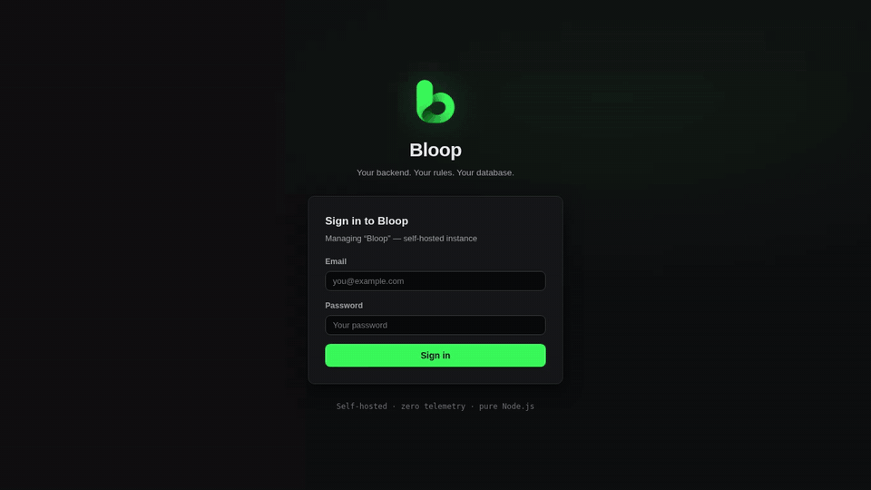

<div align="center">

# 🐟 Bloop

**Your backend. Your rules. Your database.**

A complete backend platform that runs on **your own computer or server**.
One command starts it. No cloud account. No monthly bill. Your data stays with you.



`Version 1.0.0` · `Node.js 22.5+` · `Works on Windows, Linux and macOS` · `MIT License`

</div>

---

## 📖 Table of contents

1. [What is Bloop?](#1-what-is-bloop)
2. [What you get](#2-what-you-get)
3. [What you need before you start](#3-what-you-need-before-you-start)
4. [Install and run](#4-install-and-run)
5. [First-time setup](#5-first-time-setup)
6. [Your first project](#6-your-first-project)
7. [A tour of the dashboard](#7-a-tour-of-the-dashboard)
8. [Connect your app with API keys](#8-connect-your-app-with-api-keys)
9. [Store and read data (REST API)](#9-store-and-read-data-rest-api)
10. [Live updates with WebSockets](#10-live-updates-with-websockets)
11. [GraphQL](#11-graphql)
12. [File storage](#12-file-storage)
13. [Login system (authentication)](#13-login-system-authentication)
14. [Serverless functions](#14-serverless-functions)
15. [The startup sound 🎵](#15-the-startup-sound-)
16. [Changing settings (configuration)](#16-changing-settings-configuration)
17. [Command line commands](#17-command-line-commands)
18. [Plugins](#18-plugins)
19. [Backups](#19-backups)
20. [Where your files live (project structure)](#20-where-your-files-live-project-structure)
21. [Keeping it safe (security)](#21-keeping-it-safe-security)
22. [Problems and fixes (troubleshooting)](#22-problems-and-fixes-troubleshooting)
23. [Questions people ask (FAQ)](#23-questions-people-ask-faq)
24. [License](#24-license)

---

## 1. What is Bloop?

When you build an app (a website, a mobile app, a game), your app needs a place to:

- **store data** — users, posts, orders, scores… anything,
- **check who people are** — sign up, log in, keep them logged in,
- **save files** — pictures, PDFs, videos,
- **tell other apps when something happens** — "a new user just joined!".

Normally you would build all of that yourself, or pay a big cloud company (like Firebase or Supabase) to do it. Those cloud services keep **your data on their computers**.

**Bloop is that same kind of service, but it runs on YOUR computer.** It is one program that gives your apps a database, a login system, file storage, live updates and more — all in one place, with a website (the **dashboard**) to manage everything.

Think of it like this:

| Without Bloop | With Bloop |
| --- | --- |
| Install a database program. Learn its language. | Bloop makes one for you automatically. |
| Write login code. Store passwords safely. | Bloop has login, sign-up and sessions ready. |
| Build file upload servers. | Bloop stores files with one API call. |
| Write special code to push live updates. | Bloop pushes live updates automatically. |
| Your data sits on someone else's cloud. | Your data sits on your own disk. |

A few words explained simply (they are used a lot in this file):

- **API** — a way for programs to talk to each other over the internet, using web addresses (URLs).
- **Dashboard** — the control website that Bloop shows you in your browser.
- **Project** — one space inside Bloop for one app. Each project gets its own database, keys and files.
- **API key** — a secret password-like string your app sends so Bloop knows the request is allowed.
- **Realtime** — data that arrives instantly, without the app asking again and again.

One thing that makes Bloop special: it is built on **pure Node.js with zero runtime dependencies**. That means it does not pull in hundreds of other people's packages to run — the parts that matter (the WebSocket server, the GraphQL engine, ZIP handling, even password hashing) are built in. Fewer parts means fewer things that can break, and `npm install` finishes fast.

---

## 2. What you get

Everything below is included. Nothing extra to install.

| Feature | What it means in simple words |
| --- | --- |
| 🗄️ **Database** | Every project gets its own SQLite database created for you. You can also connect PostgreSQL, MySQL, MariaDB, MongoDB or BadgerDB. |
| ✍️ **SQL Editor** | Type SQL commands in the dashboard and see results right away. Many statements at once, saved queries, history, CSV/JSON export. |
| 🧭 **NoSQL Explorer** | Store JSON documents without writing any SQL. Works with an embedded store or real MongoDB. |
| 🔐 **Authentication** | Sign up, log in, password reset, email check, sessions, two-factor login (TOTP), passkeys (fingerprint/face), and "Sign in with Google / GitHub / Discord". |
| 🚪 **REST API** | Simple web addresses like `POST /api/v1/<projectId>/db/<table>` to create, read, change and delete data. A ready-made OpenAPI file describes it all. |
| 🔮 **GraphQL** | Ask for exactly the data you want, in one request. Comes with a playground to try it. |
| 📡 **Realtime** | WebSockets push every data change to all connected apps instantly. No extra setup — subscribe and watch. |
| 📦 **Storage** | Upload and download files ("buckets" = folders for files). Saves to your disk or any S3-compatible service. Signed temporary links included. |
| ⚡ **Functions** | Small JavaScript functions that run on the server when called — with timeouts and memory limits so they stay safe. They can run on a schedule (cron) or when data changes (triggers). |
| 🪝 **Webhooks** | Bloop can call a web address you choose when something happens (for example "row inserted"). |
| 🧩 **Plugins** | Add extra features by dropping a folder with a `manifest.json` into the `plugins/` directory. |
| 📊 **Analytics & Logs** | See how much your projects are used, and read what the server did and when. |
| 💾 **Backups** | Save and restore encrypted backup copies of your projects. |
| 🖥️ **Dashboard** | A full control website with dark theme, command palette (Ctrl+K), project switcher and a startup sound. |
| 🧰 **CLI & SDKs** | Start/stop/check from the command line, and generate client code for JavaScript/TypeScript, Python, Go or Dart. |
| 📥 **Importers** | Moving from Supabase, Firebase, PocketBase or Appwrite? Bloop can import your data. |
| 🌍 **Self-hosted** | Runs at `http://localhost:8090` on your machine. Put it on a server and reach it from anywhere. |

---

## 3. What you need before you start

You only need **one thing**:

- **Node.js version 22.5 or newer.** Node.js is the program that runs JavaScript on your computer. Download it free at [nodejs.org](https://nodejs.org) (choose the "LTS" version).

Check what you have by opening a terminal (on Windows: PowerShell or CMD) and typing:

```bash
node --version
```

If you see `v22.5.0` or a bigger number, you are good to go.

That's all. Bloop does **not** need Docker, Python, a database program, or an internet account. Everything else is inside the ZIP you already have. (If you like Docker, there is a `docker-compose.yml` too — but it is optional.)

---

## 4. Install and run

### Step 1 — Unpack

Unzip the `bloop.zip` file anywhere you like, for example:

```text
Windows:  C:\bloop
Linux:    ~/bloop
macOS:    ~/bloop
```

### Step 2 — Install

Open a terminal **inside that folder** and type:

```bash
npm install
```

Because Bloop has zero runtime dependencies, this finishes quickly. You only do it once.

### Step 3 — Start

```bash
npm start
```

You will see messages saying Bloop started, and the address it runs on.

> Prefer Docker? `docker compose up -d` does the same thing in a container.

### Step 4 — Open the dashboard

Open your browser and go to:

```text
http://localhost:8090
```

That is it. Bloop is running. 🎉

> `localhost` means "this computer". Port `8090` is like a door number — [you can change it](#16-changing-settings-configuration).

### Step 5 — Stop it (when you want)

Press `Ctrl+C` in the terminal, or run this from another terminal:

```bash
npm stop
```

---

## 5. First-time setup

The **first time** you open `http://localhost:8090`, Bloop shows a short form:

1. **Email** — any address you want to use as the boss account (it does not send you mail, it is just a username).
2. **Password** — at least **10 characters**. This is the password for the dashboard, so make it a good one.
3. **Name** — how Bloop greets you.

After you save this, you are the **owner** (the boss) of this Bloop instance. The next time you visit, you just log in with that email and password.

Good to know:

- If you enable **two-factor login (TOTP)** later (in Settings → Admin account), you will also type a 6-digit code from an app like Google Authenticator.
- Your dashboard login stays valid for **12 hours** so you are not asked for the password again and again. A hidden "refresh" process keeps you logged in for up to **30 days** on the same browser.

---

## 6. Your first project

A **project** is one safe box for one app. Click **Projects** in the left sidebar → **New project** → give it a name → **Create**.

Bloop instantly prepares all of this for the new project, with zero extra work from you:

| What it makes | Why |
| --- | --- |
| A **SQLite database** | Your app's data lives here. |
| **dev / staging / prod** environments | Try things safely before "going live". |
| **anon** and **service_role** API keys | Your app uses these to talk to Bloop (explained below). |
| A **storage directory** | Where uploaded files go. |

Every project gets an ID that looks like `9d3bddf0-d248-45d2-84f1-5df61d4101df`. You will use this ID in your app's web addresses (URLs).

You can also **duplicate** a project (a full copy to play with) and **export** one (a single file with everything inside).

---

## 7. A tour of the dashboard

The left sidebar is your map. Here is what every page does:

| Page | What you do there |
| --- | --- |
| **Overview** | Health of the platform, quick stats about the selected project. |
| **Projects** | Create projects, switch between them, duplicate or export them. |
| **Database** | See tables, their columns and rows. Create and edit data with forms. |
| **SQL Editor** | Write SQL (`SELECT`, `INSERT`, …), run many statements at once, see history. |
| **NoSQL Explorer** | Create JSON "collections" and store documents without SQL. |
| **Authentication** | Turn login features on and off (email check, password rules, MFA, passkeys, social login). |
| **Users** | See everyone who signed up in your app; disable or manage them. |
| **Storage** | Make file buckets, upload and browse files. |
| **API Explorer** | Try every REST endpoint from the browser, manage API keys, see the OpenAPI file. |
| **GraphQL** | Open the GraphQL playground and run queries. |
| **Realtime** | Watch the live WebSocket feed. It connects by itself and shows every data change as it happens. |
| **Functions** | Write small server-side JavaScript functions and call them by name. |
| **Webhooks** | Tell Bloop to call your URL when events happen. |
| **Analytics** | Charts of usage: requests, storage size, activity over time. |
| **Logs** | Read the server's diary: what happened and when. |
| **Backups** | Make and restore backup copies of projects. |
| **Plugins** | Install plugins from a folder or a ZIP file. |
| **Settings** | Server settings, security, your admin account, and dashboard preferences (like the startup sound). |

Tips you will like:

- Press **Ctrl+K** anywhere for the command palette — type what you want to jump to.
- Click the moon/sun icon to switch **dark/light theme**.
- Select a project at the top; the pages below then work inside that project.

---

## 8. Connect your app with API keys

Your app (website, mobile app, script…) talks to Bloop using **API keys**. There are two special keys per project:

| Key | Who should use it | Power |
| --- | --- | --- |
| **anon** | Browsers and mobile apps (the public) | Only what "row security" allows — safe to expose |
| **service_role** | Your own private server code | **Everything** — bypasses all rules. **Never put this in a browser app!** |

### Where do I find them?

In the dashboard, press **Ctrl+K** → "Connection info & API keys", or click the **Connect** button at the top. The window shows the Project ID, the API base URL and both keys, with copy buttons.

### Making your own keys

Open **API Explorer** → "API keys" → **New key**. You can choose its type and **scopes** (what it is allowed to do), for example:

```json
[
  { "domain": "db", "actions": ["read", "write"] }
]
```

That key may only read and write the database — nothing else. Keys are stored as a **hash** (Bloop keeps only a scrambled fingerprint of the key, not the key itself), so you must copy a key when you first make it.

You can **revoke** (turn off) a key any time from the same table — apps using it stop working immediately.

No password re-typing needed: viewing and creating keys just works while you are logged in.

---

## 9. Store and read data (REST API)

This is the most common way apps talk to Bloop. The pattern is always:

```text
http://localhost:8090/api/v1/<projectId>/db/<tableName>
```

Say your Project ID is `9d3b…101df`, your table is `products`, and your anon key is `bk_anon_…`:

### Add a row

```bash
curl -X POST http://localhost:8090/api/v1/9d3b…101df/db/products \
  -H "Authorization: Bearer bk_anon_…" \
  -H "Content-Type: application/json" \
  -d '{"name": "Coffee Mug", "price": 12.5}'
```

### Read rows

```bash
curl "http://localhost:8090/api/v1/9d3b…101df/db/products?limit=10" \
  -H "Authorization: Bearer bk_anon_…"
```

### Change a row

```bash
curl -X PATCH http://localhost:8090/api/v1/9d3b…101df/db/products/1 \
  -H "Authorization: Bearer bk_anon_…" \
  -H "Content-Type: application/json" \
  -d '{"price": 14.0}'
```

### Delete a row

```bash
curl -X DELETE http://localhost:8090/api/v1/9d3b…101df/db/products/1 \
  -H "Authorization: Bearer bk_anon_…"
```

The same thing in **JavaScript** (for a website):

```js
const BASE = "http://localhost:8090";
const PROJECT = "9d3b…101df";        // your project id
const KEY = "bk_anon_…";             // your anon key

async function getProducts() {
  const res = await fetch(`${BASE}/api/v1/${PROJECT}/db/products`, {
    headers: { Authorization: `Bearer ${KEY}` },
  });
  return res.json();
}
```

Notes:

- You need a **table** first. Make one in the dashboard (Database page → New table) or with the SQL Editor: `CREATE TABLE products (...)`.
- Filters are simple: `?category=audio&order=price` picks rows and sorts them; `?limit=10&offset=20` gives page by page.
- Bloop ships an **OpenAPI** file that describes every endpoint automatically: `GET /api/v1/<projectId>/openapi.json` — paste it into tools like Postman or Swagger UI.
- To block strangers from reading private data, use **row security policies** (Database page) — rules like "a user can only read their own rows".

---

## 10. Live updates with WebSockets

This is the magic part, and it works **out of the box**. A WebSocket is a phone line between your app and Bloop that stays open — Bloop can whisper "something changed!" the moment it happens.

**You do not have to switch anything on.** Every time a row is created, changed or deleted (through REST, SQL or NoSQL), Bloop broadcasts the change to everyone watching.

### Where to watch

The address is:

```text
ws://localhost:8090/realtime/v1
```

(`ws://` is like `http://` but for WebSockets. If your server uses HTTPS, use `wss://` instead.)

### Channels

You choose what to listen to with a **channel name**:

| Channel | You hear… |
| --- | --- |
| `project:<projectId>` | **Every change in the whole project** |
| `project:<projectId>:db:<table>` | Only changes in one table |
| `project:<projectId>:broadcast:<name>` | Custom messages your apps send each other |
| `project:<projectId>:presence:<name>` | Who is online right now ("typing…", live cursors) |

### Example: hear every new row instantly

Paste this in your browser's console (F12) after logging into any app:

```js
const ws = new WebSocket("ws://localhost:8090/realtime/v1");

ws.onopen = () => {
  ws.send(JSON.stringify({
    op: "subscribe",
    channel: "project:9d3b…101df:db:products"
  }));
};

ws.onmessage = (event) => {
  const msg = JSON.parse(event.data);
  if (msg.type === "data") {
    console.log(`${msg.op} on ${msg.table}`, msg.rows);
    // → "insert on products" [{ name: "Coffee Mug", price: 12.5, ... }]
    // Update your screen here — no reload needed!
  }
};
```

### Try it without writing code

Open the **Realtime** page in the dashboard. It **connects automatically** and shows a live event feed. Now change some data (SQL Editor or your app) and watch the event appear in the feed right in front of you. That is also an easy way to test your app's sync.

### Filters and presence

- Subscribe with a `filter` to get only matching rows: `{"op":"subscribe","channel":"project:<id>:db:orders","filter":{"status":"paid"}}`.
- Presence channels report who is connected and let members share small state (like a cursor position).

---

## 11. GraphQL

GraphQL lets the app ask for exactly the fields it wants in one request.

- **Endpoint:** `POST /api/v1/<projectId>/graphql`
- **Playground:** open `http://localhost:8090/#/graphql` in the dashboard — it has an interactive editor with the schema ready.

Example:

```graphql
query {
  products(limit: 5) {
    id
    name
    price
  }
}
```

GraphQL uses the same API keys and the same row security as REST. Queries (reading), mutations (writing) and relationships (related tables in one request) are supported.

---

## 12. File storage

Buckets are folders for files. Create one in the dashboard (**Storage** page → New bucket), then:

### Upload a file

```bash
curl -X PUT "http://localhost:8090/api/v1/<projectId>/storage/photos/cat.jpg" \
  -H "Authorization: Bearer <key>" \
  --data-binary @cat.jpg
```

### Download it back

```text
GET http://localhost:8090/api/v1/<projectId>/storage/photos/cat.jpg
```

### Private files with signed links

For buckets that are not public, ask Bloop for a **signed URL** — a temporary link that works for a short time and then expires:

```bash
curl -X POST "http://localhost:8090/api/v1/<projectId>/storage/photos/sign" \
  -H "Authorization: Bearer <key>" \
  -H "Content-Type: application/json" \
  -d '{"path": "cat.jpg", "ttlSeconds": 300}'
```

Storage saves to your disk by default (`storage/` directory). With a small config change it can use any **S3-compatible** service (Amazon S3, MinIO, Cloudflare R2…) instead. Buckets support **policies** (who may read/write), **versioning** (keep old copies of changed files) and MIME checking (only the file types you allow).

---

## 13. Login system (authentication)

Every project gets a complete login system. These are the main ready-made endpoints (`/api/v1/<projectId>/auth/...`):

| Action | Endpoint |
| --- | --- |
| Sign up | `POST /auth/register` |
| Log in | `POST /auth/login` |
| Log out | `POST /auth/logout` |
| Refresh a session | `POST /auth/refresh` |
| Who am I? | `GET /auth/me` |
| Change my password | `POST /auth/me/password` |
| Delete my account | `POST /auth/me/delete` |
| Password reset (send + confirm) | `POST /auth/password-reset`, `POST /auth/password-reset/confirm` |
| Two-factor login | `POST /auth/totp/enable`, `POST /auth/mfa/verify`, `POST /auth/totp/disable` |
| Passkeys (fingerprint / face) | `POST /auth/passkeys/register`, `POST /auth/passkeys/login` |
| Social login | Google, GitHub, Discord (configured in the Authentication page) |
| Sessions list and kill | `GET /auth/sessions`, `POST /auth/sessions/revoke-all` |

Example — sign up a user:

```bash
curl -X POST http://localhost:8090/api/v1/<projectId>/auth/register \
  -H "Content-Type: application/json" \
  -d '{"email": "user@example.com", "password": "supersecret1"}'
```

After logging in, your app receives a **token** (a short string). Your app sends that token with every request so Bloop knows who the user is. Tokens expire, but `POST /auth/refresh` gives a new one without making the person log in again. Passwords are protected with **scrypt** (a slow, strong hashing method), and refresh tokens **rotate** — a stolen old token stops working.

Turn features on/off and tune password rules in the dashboard → **Authentication** page.

---

## 14. Serverless functions

Functions are small JavaScript programs that live inside Bloop. Call them from any app with one URL:

```text
POST /api/v1/<projectId>/functions/<slug>
```

Write and test them in the dashboard (**Functions** page). Use cases: send a welcome email, calculate a discount, talk to another service.

Functions run in a locked box ("sandbox") with a **time limit** and a **memory limit**, so a broken function can never hang the server. They can also run:

- **on a schedule** (cron) — "every night at 3:00",
- **on a trigger** — "whenever a row is added to orders".

They run with the permissions you give them — nothing more.

---

## 15. The startup sound 🎵

Bloop can play a little sound when the dashboard opens. You choose the sound:

1. Find (or make) a short audio file you like.
2. Rename it exactly to:

```text
startup.mp3
```

3. Drop it into the **`frontend/assets/`** folder, next to the logo:

```text
bloop/
└── frontend/
    └── assets/
        ├── logo.png
        └── startup.mp3   ← your file here
```

That's it. Next time the dashboard opens, it plays at a comfortable volume.

- `.wav` and `.ogg` files also work (`startup.wav`, `startup.ogg`) — but the name must always be `startup` + that ending.
- No file yet? Nothing breaks — Bloop quietly skips the sound.
- Turn it off or test it: **Settings → Dashboard preferences → "Play the startup sound"** (there is a **Test** button too).
- First visit after login: browsers sometimes block sound until you click somewhere once. One click and it will play from then on.

---

## 16. Changing settings (configuration)

Bloop reads settings from files, in this order (later files win):

1. **`config/default-config.json`** — the built-in defaults. Do not edit this file.
2. **`config/config.json`** — create this file and put only your changes in it.
3. **Environment variables** — for servers (Docker, CI) that prefer settings that way.

Things you may want to change:

| Setting | Default | What it does |
| --- | --- | --- |
| `server.port` | `8090` | The door number of the dashboard and API. |
| `realtime.path` | `/realtime/v1` | The WebSocket address. |
| `realtime.enabled` | `true` | Turn the realtime engine off completely. |
| `storage.provider` | `local` | `local` disk or an S3-compatible service. |
| `plugins.directory` | `plugins` | Where Bloop looks for plugin folders. |

Example `config/config.json` that changes the port:

```json
{
  "server": { "port": 3000 }
}
```

Restart Bloop after changing a file.

---

## 17. Command line commands

All commands run in the bloop folder:

| Command | What it does |
| --- | --- |
| `npm start` | Start Bloop in the background. |
| `npm run dev` | Start with developer-friendly logging. |
| `npm stop` | Stop Bloop. |
| `npm run status` | Is Bloop running? What port? |
| `npm run doctor` | Check the installation for problems (very useful when something feels wrong). |
| `npm test` | Run the built-in test suite. |

There is also `node bloop.js help` to see everything the CLI can do.

---

## 18. Plugins

Plugins add features to Bloop without changing its core code. A plugin is just a folder with two things:

```text
plugins/
└── my-plugin/
    ├── manifest.json     ← says what it is and what it may do
    └── index.js          ← the code
```

`manifest.json` example:

```json
{
  "name": "my-plugin",
  "version": "1.0.0",
  "description": "Adds a hello route",
  "permissions": ["routes", "events"]
}
```

`index.js` example:

```js
export function register(ctx) {
  ctx.router.get("/api/v1/hello", (req, res) => res.json(200, { hi: "there" }));
}
```

Install it in the dashboard: **Plugins → Install from path or .zip**. Bloop restarts the plugin when you enable or disable it. The built-in `hello-bloop` example plugin shows everything a plugin can do.

Plugins **declare permissions** ("routes", "events", "settings"…) and Bloop only gives them what they declared.

The marketplace page is **honestly empty** by design — Bloop does not pretend to have a fake store. You can point it at your own registry URL in settings.

---

## 19. Backups

Two ways to keep your data safe:

1. **Dashboard → Backups** — make a backup of a project and restore it later with a few clicks. Backups are **ZIP files protected with AES-256 encryption** (a strong, standard method), so they are safe to store or send.
2. **Manual** — stop Bloop and copy the whole `storage/` folder somewhere safe. That folder holds your settings, users and (for SQLite projects) the database files themselves.

Rule of thumb: make a backup before big changes, and keep one backup outside the computer if the data matters.

---

## 20. Where your files live (project structure)

```text
bloop/
├── bloop.js               ← the starter (npm start runs this)
├── backend/               ← the server code (Node.js)
│   ├── core/              ← server, router, config, project manager
│   ├── modules/           ← database, auth, storage, realtime, functions…
│   └── infrastructure/    ← admin API, CLI, marketplace, providers
├── frontend/              ← the dashboard (plain HTML/JS, no build step)
│   ├── assets/            ← logo.png and your startup.mp3
│   └── *.js               ← one file per dashboard page
├── config/                ← default-config.json (defaults) + your config.json
├── storage/               ← YOUR DATA (settings, sessions, databases, files)
├── plugins/               ← plugins live here (hello-bloop example included)
├── docs/                  ← this README's images
├── logs/                  ← server logs
├── backups/               ← backups made from the dashboard
└── tests/                 ← test suite (npm test)
```

⚠️ **The `storage/` folder is your data.** Back it up, and never delete it unless you want a factory reset (which also deletes the dashboard login).

---

## 21. Keeping it safe (security)

- **Keep `service_role` keys secret.** They bypass all rules. Only private server code should ever have them. The dashboard warns you about this too.
- **Use row security policies** for anything users can read or write — they limit each user to their own rows.
- **HTTPS:** for a server on the internet, put Bloop behind a reverse proxy with HTTPS (for example Nginx or Caddy). Locally, `http://localhost` is fine.
- **Admin password:** choose a long one (10+ characters), and turn on **TOTP** two-factor login in Settings → Admin account for extra safety.
- **Sessions:** dashboard logins last 12 hours (with a 30-day refresh on the same browser). Project user tokens are separate and refreshable.
- **Secrets are encrypted** at rest — OAuth secrets and bootstrap keys are stored encrypted, not as plain text.
- **Keys are hashed** at rest — even if someone reads the database file, they cannot get the original keys back.
- **Firewalls:** Bloop only opens the port you configured (default `8090`).

---

## 22. Problems and fixes (troubleshooting)

**`npm start` says "port already in use"**
Something else is using port 8090. Change the port (see [configuration](#16-changing-settings-configuration)) or stop the other program. `npm run doctor` can help you find what is wrong.

**`npm install` fails**
Check that Node.js is version 22.5 or newer (`node --version`). Delete the `node_modules` folder and try again.

**I forgot the dashboard password**
Run `npm run doctor` and follow its instructions, or delete `storage/system/` to restart setup (⚠️ this also removes other platform settings — not project data).

**The startup sound does not play**
- Check the file is named exactly `startup.mp3` and sits in `frontend/assets/`.
- Browsers block sound until your first click on the page — click once and it plays on the next load.
- Check the toggle: Settings → Dashboard preferences.

**WebSocket does not connect from my app**
- Use `ws://` for `http://` servers and `wss://` for `https://` servers — mixing them up is the number one cause.
- The channel must match `project:<projectId>` (or `…:db:<table>`, `…:broadcast:<name>`, `…:presence:<name>`).

**The Plugins page shows an error**
Make sure you are running the latest build (this version fixed the marketplace endpoint). `npm run doctor` and the `logs/` folder will show details.

**"Failed to render page …"**
Refresh with Ctrl+F5 (the dashboard caches old files). If it still fails, look in `logs/` and check the GitHub issues.

---

## 23. Questions people ask (FAQ)

**Is my data really only on my machine?**
Yes. Bloop talks to no cloud service. The marketplace page stays empty unless you point it to a registry yourself.

**Can I use PostgreSQL / MySQL / MongoDB instead of SQLite?**
Yes — connect them in the dashboard (Database page → connections). Your project can even mix: SQL tables for some data, JSON collections for other data.

**Can several apps use one Bloop server?**
Yes — make one **project** per app. Each project has its own database, keys and files, so apps never mix data.

**Do I need to write SQL?**
No. The Database page and NoSQL Explorer let you work with clicks and forms. SQL is there when you want it.

**How many people can use it at once?**
Realtime supports up to 200 connections per project by default, and the REST API is rate-limited to keep the server healthy. For a typical app this is plenty; tune the limits in config.

**Can I move my data from Supabase or Firebase?**
Yes — Bloop has importers for Supabase, Firebase, PocketBase and Appwrite. Export there, import here.

**Is it free?**
Bloop is MIT-licensed open source. Use it for anything, including commercial projects.

**Does it work offline?**
Yes, completely. Install, run, use — no internet needed.

---

## 24. License

[MIT](LICENSE) — © 2026 Bloop Contributors. Use it, change it, ship it.

<div align="center">

**Bloop — your backend, running on your machine, in one command.** 🐟

`npm install` → `npm start` → `http://localhost:8090`

</div>
